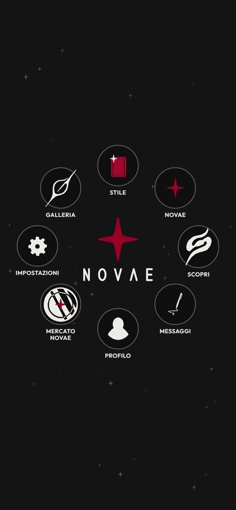
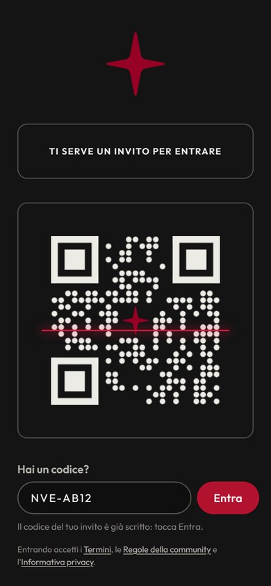
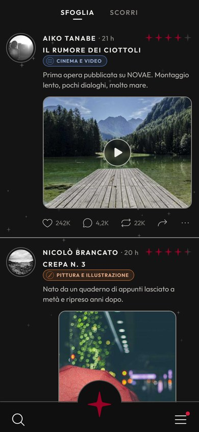
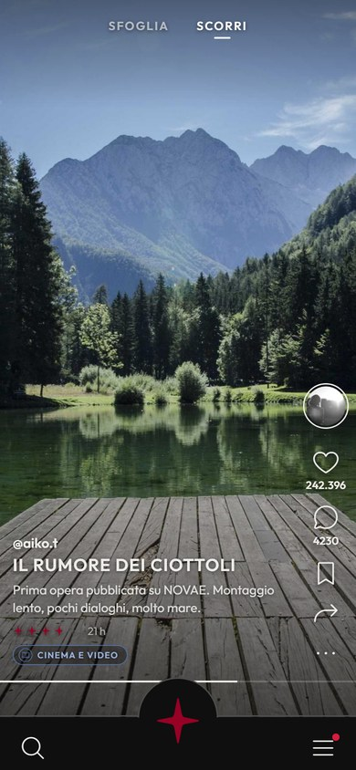
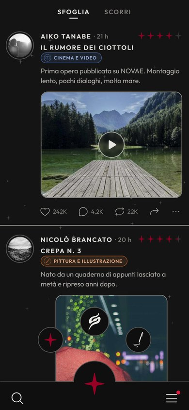
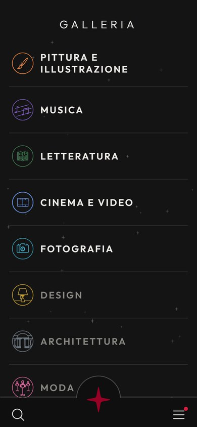
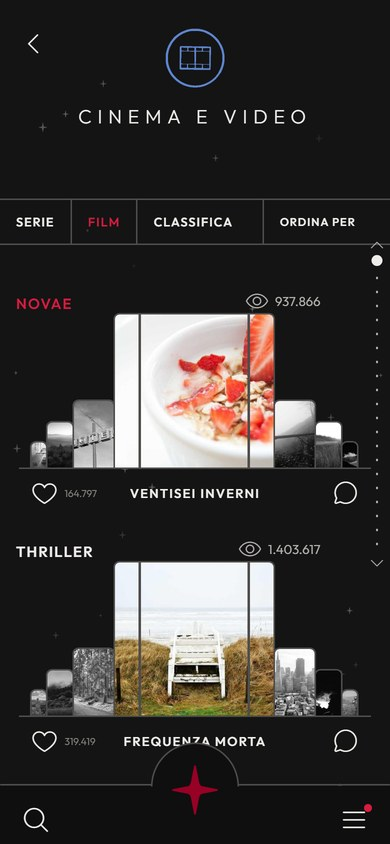
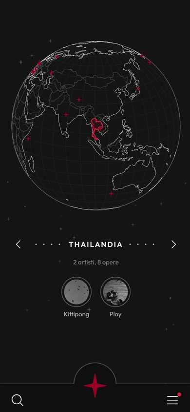
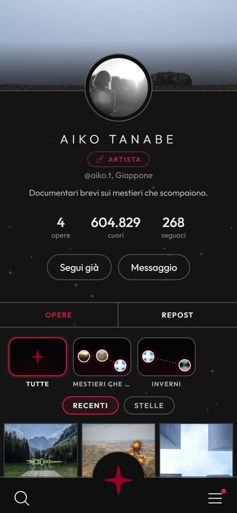

<div align="center">



# NOVAE

**Il social su invito dove gli artisti condividono le loro opere.**

### [Apri il sito → xandre04.github.io/novae](https://xandre04.github.io/novae/)


[](LICENSE)

</div>

---

NOVAE è un social pensato per chi crea: registi, pittori, fotografi, musicisti, illustratori, scultori, poeti. Ogni artista pubblica le sue opere; gli altri le guardano, le commentano e seguono chi le ha fatte. Le stelle le danno solo i critici.

Si entra **solo su invito**: serve il codice (o il QR) di qualcuno che è già dentro.

> [!NOTE]
> Questa è una **super alpha**: un prototipo navigabile per provare l'esperienza. Non c'è ancora un server: artisti e opere sono di esempio, le immagini sono foto segnaposto e quello che fai (mi piace, salvataggi, opere pubblicate) resta solo nel tuo browser.

## Come provarlo

1. Apri **[xandre04.github.io/novae](https://xandre04.github.io/novae/)**, meglio dal telefono.
2. Nella schermata d'invito scrivi un codice qualsiasi di almeno 4 caratteri (ad esempio `NVE-7K2Q`) e tocca **Entra**.
3. Dal menu a stella scegli dove andare, oppure usa la stella in basso per aprire la ruota delle sezioni.
4. I tre trattini in basso a destra aprono notifiche, crea, codice QR e segnala un problema.

### Installarla come app

NOVAE si installa dal sito, senza store: icona sulla schermata Home, schermo intero, e le pagine già viste si aprono anche senza connessione.

- **iPhone (Safari):** **Condividi** → **Aggiungi alla schermata Home**.
- **Android (Chrome):** menu **⋮** → **Installa app**.

## Schermate

| Invito | Menu principale | Scopri: Sfoglia |
|:---:|:---:|:---:|
|  |  |  |
| **Scopri: Scorri** | **Ruota delle sezioni** | **Galleria** |
|  |  |  |
| **Cinema e video** | **Novae (il pianeta)** | **Profilo di un artista** |
|  |  |  |

## Cosa c'è dentro

**Sezioni**

- **Invito**: si entra con un codice o un QR.
- **Menu principale**: le 8 sezioni attorno alla stella NOVAE.
- **Scopri**: due modi di guardare le stesse opere, scelti in alto.
  - **Sfoglia**: il feed a post, in stile X. Tocca l'immagine per vederla da sola a schermo intero; tocca il resto del post o il fumetto per i commenti.
  - **Scorri**: le opere a schermo intero una dopo l'altra, come Reels e TikTok. Tocca per mettere in pausa, doppio tocco per il mi piace.
- **Galleria**: le 21 categorie, da Pittura e illustrazione ad Arte memetica, ognuna con la sua icona e il suo colore. In **Cinema e video**: serie, film e classifica, con le righe a gradini per genere.
- **Novae**: il pianeta. Giralo (ha un po' di slancio) e scopri gli artisti di ogni paese.
- **Scheda opera**: player, descrizione completa e opere correlate.
- **Mercato**: opere in vendita, con prezzi in crediti.
- **Stile**: in arrivo.
- **Profilo, Messaggi, Impostazioni**.

**Cose che puoi fare**

- **Scegliere il tipo di profilo**, ognuno con il suo badge:
  - **artista**: pubblica opere e le raccoglie in **costellazioni** (piccoli cieli di opere unite da una linea, sopra la griglia del profilo);
  - **critico**: l'unico che può dare le **stelle**; le sue recensioni prendono il posto dei post sul profilo;
  - **utente**: può pubblicare, ma le sue opere le vede **solo chi lo segue**.
- **Pubblicare un'opera** dal profilo (immagine, titolo, categoria, descrizione), poi modificarla o eliminarla dai tre puntini.
- **Personalizzare il profilo**: banner, nome, nome utente e bio.
- **Salvare** un'opera e ritrovarla in *Profilo → Salvate*; **seguire** gli artisti e scrivere loro nei messaggi.
- **Invitare qualcuno**: tre trattini → *Codice QR*. Il QR apre NOVAE con il codice già scritto; ognuno ha 3 inviti, validi 14 giorni.
- **Segnalare un'opera** dai tre puntini, scegliendo il motivo (nell'alpha la segnalazione resta sul telefono).
- **Usarla in inglese**: *Impostazioni → Lingua*. La prima volta segue la lingua del telefono. Si traduce l'interfaccia; quello che scrivono le persone resta com'è.
- **Leggere le regole**: Regole della community, Termini d'uso e Privacy, in *Impostazioni* e nella schermata d'invito (bozze da far rivedere a un legale).

**Scorciatoie**

| Gesto o tasto | Cosa fa |
|---|---|
| Doppio tocco su un'opera | Mi piace |
| Trascinare la ruota della stella | Scegliere la sezione (anche rotellina o frecce ← →) |
| Doppio tocco sulla stella | Tornare al menu principale |
| Trascinare giù un pannello | Chiuderlo |
| Trascinare giù il feed dall'alto | Aggiornare il feed |
| `/` | Cercare opere e artisti |
| `Esc` | Chiudere pannelli, anteprima, ricerca e ruota |
| Frecce ↑ ↓ in Scorri, ← → in Novae | Opera precedente o successiva, paese precedente o successivo |

## Design

Nero profondo (`#141414`), linee sottili, una sola stella cremisi a quattro punte (`#960125`) come accento, e il carattere [Outfit](https://fonts.google.com/specimen/Outfit).

Tutto parte da disegni fatti a mano:

- **Logo**: la stella e la scritta "N O V Λ E" sono ridisegnate in vettoriale a linee pulite ([`assets/svg/stella.svg`](assets/svg/stella.svg), [`assets/svg/wordmark.svg`](assets/svg/wordmark.svg)).
- **Icone delle sezioni**: i disegni sono in [`assets/icone/sezioni/`](assets/icone/sezioni/), ricalcati in SVG in [`assets/svg/`](assets/svg/).
- **Icone delle categorie**: i disegni sono in [`assets/icone/categorie/`](assets/icone/categorie/); le versioni SVG in [`assets/categorie/`](assets/categorie/) sono ridisegnate a mano (cerchio perfetto, linee dritte) da [`tools/draw-icons.py`](tools/draw-icons.py). Pittura, Cinema e Scultura sono ancora ricalcate dal disegno con [`tools/trace-icons.py`](tools/trace-icons.py).
- **Bozzetti delle schermate**: in [`docs/bozzetti/`](docs/bozzetti/).

### Aggiungere l'icona di una categoria

1. Metti il disegno in `assets/icone/categorie/` con il nome della categoria in minuscolo e con i trattini (es. `arti-culinarie.jpg`).
2. In [`tools/draw-icons.py`](tools/draw-icons.py) aggiungi la voce con colore e forme (griglia 100×100, il cerchio è già incluso), poi lancia `python tools/draw-icons.py`.
3. In [`app.js`](app.js) aggiungi il colore in `CAT_COLORS`.
4. Alza i numeri di versione (vedi sotto), così telefoni e app installate scaricano la novità.

## Materiali per i social

In [`docs/social/`](docs/social/): icona del profilo (PNG 4096 e 1080, SVG), la stella su sfondo trasparente, il primo post (immagine 4:5 e didascalia) e il video del primo post (Reel 9:16, 10 secondi, senza audio).

Post e video sono pagine HTML che usano le icone del sito, quindi si aggiornano da sole quando cambiano le icone:

- immagine: apri [`primo-post.html`](docs/social/primo-post.html) e fai uno screenshot a 1080×1350;
- video: con il sito avviato in locale, `node tools/render-video.mjs <percorso di ffmpeg> docs/social/primo-post-video.mp4` (ffmpeg si installa con `pip install imageio-ffmpeg`).

## Avviarlo sul tuo computer

Non serve installare niente: sono file statici. Dalla cartella del progetto:

```bash
python -m http.server 5173
```

Poi apri http://localhost:5173.

## Pubblicare una modifica

Il sito è su **GitHub Pages** dal ramo `main`: ogni push aggiorna [xandre04.github.io/novae](https://xandre04.github.io/novae/) in circa un minuto.

L'app installata tiene in memoria i file, quindi quando cambi qualcosa alza i numeri di versione, altrimenti i telefoni continuano a vedere la versione vecchia:

- in [`index.html`](index.html): `styles.css?v=…`, `i18n.js?v=…`, `app.js?v=…` (quello del file che hai cambiato);
- in [`sw.js`](sw.js): il nome della cache, `novae-v…`;
- se cambi un'icona: il `?v=…` dove viene caricata (per le categorie, in `app.js`).

## Struttura del progetto

```
novae/
├── index.html              le schermate (una sola pagina)
├── styles.css              lo stile
├── app.js                  dati di esempio, navigazione e interazioni
├── i18n.js                 traduzioni in inglese dell'interfaccia
├── manifest.webmanifest    nome, icone e colori dell'app installata
├── sw.js                   service worker: funziona anche offline
├── assets/
│   ├── app/                icone dell'app (schermata Home)
│   ├── svg/                logo e icone delle sezioni (SVG)
│   ├── categorie/          icone delle categorie (SVG)
│   └── icone/              i disegni originali
│       ├── sezioni/
│       └── categorie/
├── tools/
│   ├── draw-icons.py       disegna le icone delle categorie in SVG
│   ├── trace-icons.py      ricalca i disegni in SVG (serve Python 3.13 e vtracer)
│   └── render-video.mjs    registra il video per i social
├── docs/
│   ├── screenshots/        le immagini di questo README
│   ├── bozzetti/           i disegni originali delle schermate
│   └── social/             icona, post e video per i social
├── LICENSE                 licenza MIT del codice
├── ASSETS-LICENSE.md       diritti su marchio, logo e grafiche
└── THIRD_PARTY_NOTICES.md  librerie, font e foto di terze parti
```

Librerie caricate da CDN: [Phosphor Icons](https://phosphoricons.com/), [D3](https://d3js.org/) e [world-atlas](https://github.com/topojson/world-atlas) per il globo, [qrcode-generator](https://github.com/kazuhikoarase/qrcode-generator) per il QR degli inviti, font [Outfit](https://fonts.google.com/specimen/Outfit). Le foto segnaposto arrivano da [Picsum](https://picsum.photos/).

## Licenza

- **Codice** (HTML, CSS, JavaScript e gli strumenti in `tools/`): [MIT](LICENSE).
- **Marchio e grafiche** (nome NOVAE, logo, icone, disegni, bozzetti, screenshot, materiali per i social): © 2026 Xandre04, tutti i diritti riservati. Dettagli in [`ASSETS-LICENSE.md`](ASSETS-LICENSE.md).
- **Librerie, font e foto di terze parti**: in [`THIRD_PARTY_NOTICES.md`](THIRD_PARTY_NOTICES.md).
